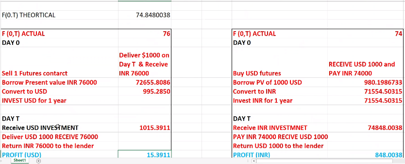

Arbitrage is the simultaneous purchase and sale of the same asset in different markets in order to profit from tiny differences in the asset's listed price. It exploits short-lived variations in the price of identical or similar financial instruments in different markets or in different forms.

## Cash-&-Carry Arbitrage

Buy the underlying in the cash/spot market and carry it until maturity.

***Benefit:*** $F_{actual,futures}>F_{theoretical,spot}$ (through the cost-of-carry model)

***At Day 0:***

1. We take a short futures position, to sell the commodity at the futures price.
2. We borrow money at the risk-free rate and buy the commodity in the spot market.

***On the day the short position ends:***

1. We deliver the commodity against the short futures and receive the futures price.
2. We repay the loan with interest. What's left over is the arbitrage profit.

## Reverse Cash-&-Carry Arbitrage

***Benefit:*** $F_{actual,futures}<F_{theoretical,spot}$

***At Day 0:***

1. We take a long futures position (to receive the underlying and pay the amount at the deadline).
2. Then we borrow a share at some interest rate.
3. We then sell this share and receive the higher spot price.
4. Then we invest the money received until the deadline.

***On the day the long position ends:***

1. We square off our long position at the deadline and pay the lower price to receive the shares.
2. We return the borrowed shares and pay the interest on them to the lender.

### Example

## Backwardation

$$
F_{0,T}<S_0
$$

This is called backwardation (the opposite, $F_{0,T}>S_0$, is contango). It happens when the underlying asset is in short supply, usually in commodity markets. To fit this into the cost-of-carry model, we add a convenience yield (CY).

$$
F_{0,T}=S_0\cdot e^{(r_f-CY)T}
$$

> 🚨 The convenience yield isn't pre-determined. It's back-calculated from the equation above using $F_{0,T}$ and $S_0$.

---

<small>Cover photo by John McArthur on [Unsplash](https://unsplash.com/photos/-ca8YHMKxFU).</small>
