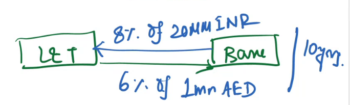
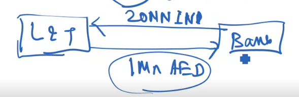
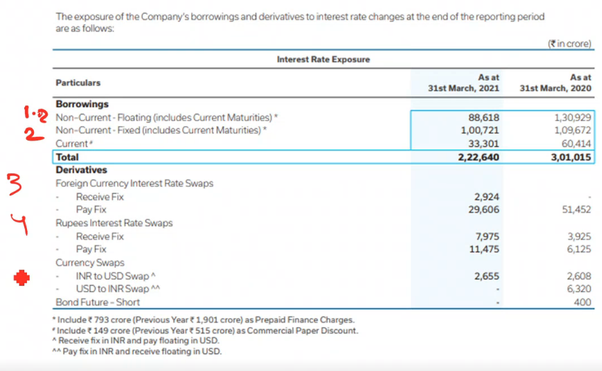

A company needs money in a foreign currency. But borrowing directly is difficult if the company is not well known in that country.

## Example

Say L&T wants to borrow 1mn AED (UAE dirham) at the current rate of 20 INR/AED. The steps are:

- L&T issues a debenture worth 20mn INR @ say 8% for 10 years.
- It then takes this money to a bank and asks for 1mn AED against it.
- It also enters into a contract where each party pays interest on the amount it received. Say 8% of 20mn INR ↔ 6% of 1mn AED for 10 years.

- At the end of 10 years, L&T and the bank exchange the original amounts back.

> 💡 Here the money is raised through an INR debenture, but the ***actual loan is in AED***. L&T is transferring its INR obligation into an AED obligation.

## RIL's Derivatives/Borrowings Positions

Here:

1. Floating coupon rate borrowings
2. Fixed coupon rate borrowings
3. Foreign currency interest rate swaps (both receive-fixed and pay-fixed)
4. Rupee interest rate swaps (both receive-fixed and pay-fixed)
5. Currency swaps, both INR/USD and USD/INR

---

<small>Cover photo by Eric Prouzet on [Unsplash](https://unsplash.com/photos/4Ah6xLAQqaU).</small>
