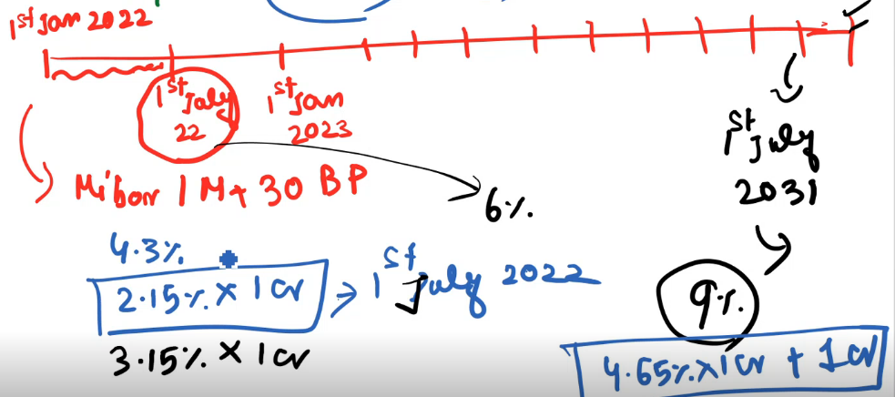
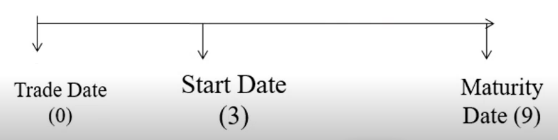
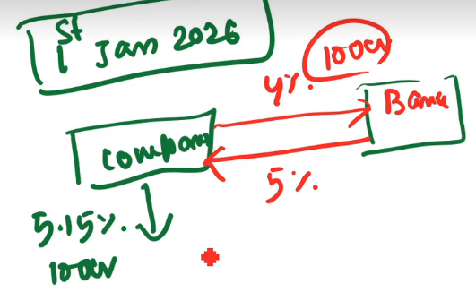
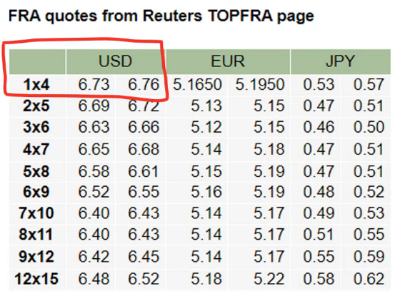
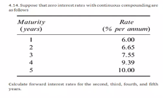
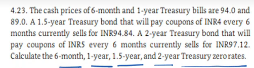
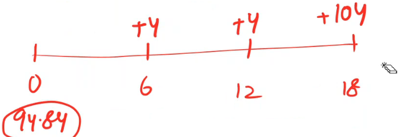

Companies issue floating-rate debentures expecting the coupon rate to fall. This leaves them exposed to a rise in the base floating rate.

So these companies enter into a Forward Rate Agreement with other parties to mitigate this risk. In an FRA, the 2 parties agree on the interest rates payable on both ends.

## Risk Mitigation with FRA

**Issue Date:** 1st Jan 2022 
**Maturity:** 10 Yr. 
**Coupon Frequency:** Semiannual 
**Coupon Rate:** MIBOR(1 Month) + 30BP 
**Principal:** 100 Cr.

### Floating Rate Coupon Calculation

Let's assume MIBOR(1M) is 4% on 1st Jan, 2022. Therefore the coupon payment on 1st July will be:

$$
\frac{4+0.3}{2}\%\cdot 100\ Cr. = 2.15\ Cr.
$$

Similarly, let the MIBOR rate on 1st July, 2022 be 6%, making the coupon payment:

$$
\frac{6+0.3}{2}\%\cdot 100\ Cr.=3.15\ Cr.
$$

### Floating Rate Risk

Now assume that midway (say on 1st Jan, 2025), the MIBOR(1-Month) rate has increased to 8%. So the coupon payable is $4.15\%\cdot 100\ Cr.$ The company now fears a massive rise in MIBOR by 1st July, 2025.

## Interest Rate Swap

So the company enters into a contract with a bank for the period **[1st July, 2025, 1st Jan, 2026]**.

For this trade:

- **Trade Date:** 1st Jan, 2025
- **Start Date:** 1st July, 2025
- **Maturity Date:** 1st Jan, 2026

> 💡 Since the trade *starts 6 months* from now and *matures 12 months* from now, we call it a ***6x12 FRA***.

Let the FRA terms be:

- The company pays a fixed 8% interest rate on the amount to the bank.
- The bank pays the MIBOR(1-Month) rate to the company.

Let the MIBOR(1M) prevailing on 1st July, 2025 be 10%.

### For the Debenture

The company has to pay $\frac{10+0.3}{2}=5.15\%$ to its investors.

### For the FRA

The company will receive a net 1% interest on the principal from the bank (for the half year).

### In Total

So the company will only be paying a fixed 4.15% interest rate to its investors.

> 💡 The interest rate after the FRA is fixed, irrespective of the floating rates.

## FRA Quotes

**1x4**    USD    [6.73  6.76]

6.73 and 6.76 are the bid and ask interest rates against LIBOR for a trade starting 1 month from now and ending 4 months from now.

i.e.

- **Bid:** The bank will buy @ LIBOR and pay 6.73%
- **Ask:** The bank will sell @ LIBOR and take 6.76%

For the company in our case, the bank's 2nd column applies, and the company is buying the FRA.

> 💡 The ***buyer of an FRA always pays a fixed rate***.

### FRA Settlements

On the start date of the FRA, the company squares off its position by paying/receiving the difference at the current interest rate, to reduce the risk of a party defaulting.

The amount due is derived as follows:

$$
Payoff=\frac{\text{Notional Principal}\cdot (\text{Fixed Rate}-\text{Reference Rate})\cdot \frac{Days}{Basis}}{(1+\text{Reference Rate}\cdot \frac{Days}{Basis})}
$$

## Forward Rate Calculation

We do these calculations based on the zero-coupon rates. For the forward rate for $(t_1\to t_2)$, we use the ZC rates $ZC_{t_1}$ and $ZC_{t_2}$.

For discrete compounding:

$$
Fwd_{(t_1,t_2)}=\left[\frac{(1+r_2)^{t_2}}{(1+r_1)^{t_1}}\right]^{\frac{1}{t_2-t_1}}-1
$$

For continuous compounding:

$$
Fwd_{(t_1,t_2)}: e^{r_1\cdot t_1}\cdot e^{Fwd_{(t_1,t_2)}\cdot (t_2-t_1)}=e^{r_2\cdot t_2}
$$

Here $Fwd_{(2,3)}: e^{6.65\%\cdot2}\cdot e^{R\%\cdot1}=e^{7.55\%\cdot3}\implies R=9.35\%$

Now let us assume that we have an FRA to pay 5% on &#36;1 mn. Since $Fwd_{(2,3)}=9.35\%$, we have a net receipt of 4.35%. So the present value of what we'll receive is:

$$
PV_{3\ yrs}=\frac{\$0.0435\ mn}{e^{0.0755\cdot3}}
$$

## Deriving the Zero-Coupon Rate

$ZC_{0\to0.5}=\frac{100-94}{94}\cdot \frac{365}{180}=12.94\%$. Similarly $ZC_{0\to1}=12.36\%$

But how do we solve for 1.5 years (18 months)? For this period, our bond payment structure is as follows:

$$
94.84=\frac{4}{(1+ZC_{0\to0.5})^{0.5}}+\frac{4}{(1+ZC_{0\to1})^{1}}+\frac{104}{(1+ZC_{0\to1.5})^{1.5}}\\
\implies 94.84=\frac{4}{(1+0.1294)^{0.5}}+\frac{4}{(1+0.1236)^{1}}+\frac{104}{(1+R\%)^{1.5}}
$$

---

<small>Cover photo by Jack Sharp on [Unsplash](https://unsplash.com/photos/d_eoQs4NvDM).</small>
