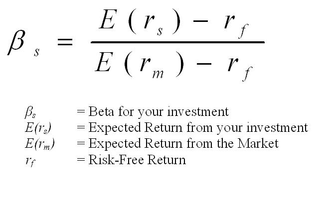
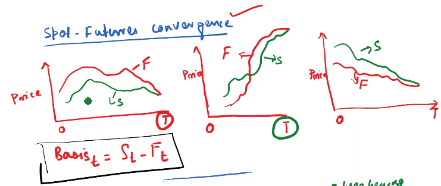

## Hedge Ratio

The hedge ratio compares the value of a position protected through the use of a [hedge](https://www.investopedia.com/terms/h/hedge.asp) with the size of the entire position itself. A hedge ratio may also be a comparison of the value of [futures contracts](https://www.investopedia.com/terms/f/futurescontract.asp) purchased or sold to the value of the cash commodity being hedged.

## Naive/1-1 Hedge

When ***spot position = futures position***. It's assumed to work perfectly when $\Delta \text{Spot Market} = \Delta \text{Futures Market}$. But the participants in the 2 markets are quite different, so this condition is almost never met.

## Portfolio Parameters

**Returns:**

$$
R_p = \sum W_i\cdot R_i
$$

**Variance:**

$$
\sigma_{R_p}^2 = W_1^2\sigma_{R_1}^2 + W_2^2\sigma_{R_2}^2 + 2W_1W_2cov(R_1,R_2)
$$

## Min. Variance Hedge Ratio (h)

Portfolio = $S - hF$

Where:

- $S$: Spot Price
- $h$: Hedge Ratio
- $F$: Futures Contract Value

$$
\text{Portfolio Risk} = \sigma_{R_S}^2 + h^2\sigma_{R_F}^2 - 2h\cdot cov(R_S,R_F)
$$

$$
\implies h=\frac{cov(R_S,R_F)}{\sigma_{R_F}^2}
$$

Now, $cov(R_S,R_F) = r_{(R_S,R_F)}\cdot \sigma_{R_S}\cdot \sigma_{R_F}$

Where ***r is the correlation***

$$
\therefore h=\frac{r\cdot \sigma_{R_S}}{\sigma_{R_F}}
$$

### Beta ($\beta$)

The beta (β) of an investment security (i.e. a stock) is **a measurement of its volatility of returns relative to the entire market**.

> 💡 [**What is $\beta$?**](https://www.investopedia.com/terms/b/beta.asp)

For a portfolio:

$$
\beta_{P}=r\frac{\sigma_P}{\sigma_M}
$$

> 💡 Mutual fund managers use index futures contracts to mitigate their risks, and in general to control their portfolio $\beta$ during market dips.

So for ***bringing $\beta$ down*** to a target value, we take a ***short futures position***:

$$
\text{\#Short Futures Contracts} = (\beta_{actual}-\beta_{target})\cdot \frac{\text{Portfolio Value}}{\text{Value of one Futures Contract}}
$$

> 💡 To ***bring $\beta$ up***, we can take a ***long futures position***.

## Basis Risk

[**Basis risk**](https://www.investopedia.com/terms/b/basisrisk.asp) is **the potential risk that arises from mismatches in a hedged position**. Basis risk occurs when a hedge is imperfect, so that losses in an investment are not exactly offset by the hedge.

> 💡 Futures help mitigate price risk by converting it into basis risk.

### Spot-Futures Convergence

## Cross Hedge

When we want to mitigate our risk on a commodity that isn't available for futures trading.

So we buy futures on a commodity closely correlated with ours and hedge our losses with it.

## Strip Hedge

Consider it a single purchase of multiple futures contracts, spread over a period of time. The contracts are for sequential delivery months, but they are traded as one single transaction.

Traders use a futures strip to speculate on prices of the underlying commodity, and typically do this ***when the futures contracts have high [liquidity](https://cleartax.in/g/terms/liquidity) over a time horizon***. This is most common in the energy futures market.

> 💡 There is *no basis risk* in a strip hedge, since the basis is locked and changes to the basis cannot affect the risk.

## Stack-and-Roll Hedge

A stack hedge, on the other hand, is buying a set of futures contracts for a nearby delivery date, and on that date, rolling the [position](https://cleartax.in/g/terms/position) forward by buying further futures contracts.

It is normally used ***when there is inadequate liquidity*** for the long-term futures contracts traded in the market.

### Risks

- Basis risk is locked only for the initial contracts; the basis exposure on later contracts stays open.
- Liquidity is higher, as instruments with short maturities are being used.
- Transaction costs are high, since this type of hedging needs more contracts.
- If the market is in backwardation, the stack strategy creates positive cash flows at roll-over dates. A short stack position generates negative cash flows under these conditions.

---

<small>Cover photo by nameless 3791 on [Unsplash](https://unsplash.com/photos/zV-RV_SUemE).</small>
