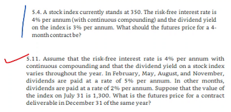

The price set for a commodity in a derivative contract is the ***Cost of Carry*** until the selected timeline.

**Cost of Carry:** the price I'll pay to buy the commodity now and store it until the selected timeline. This is assumed to be a no-loss position.

$$
F_{0,T}=S_0\cdot e^{r\cdot T}
$$

Where:

- $F_{0,T}$: The forward rate agreed for buying/selling after time $T$
- $S_0$: The current price
- $r$: The borrowing rate

> 💡 Since borrowing rates differ from person to person, the forward price will be different for everybody.

The minimum price the forward will trade at is the ***theoretical price***, which uses the risk-free rate as the borrowing rate.

$$
\text{Theoretical Price} = F_{0,T(min)}=S_0\cdot e^{r_f\cdot T}
$$

## Forward Pricing with Dividends

Some companies might pay dividends during the forward contract's timeline (say after time $t$). We can use that dividend to pay back part of our loan at that time.

$$
F(0,T)=[S_0-PV(Div,t)]\cdot e^{r_f\cdot T}
$$

Where $PV(Div,t)$ is the present value of the dividend, i.e. $PV(Div,t) = \frac{Div}{e^{r_ft}}$

## Index Forward Pricing

### Dividend Yield

The dividend yield, expressed as a percentage, is a financial ratio (dividend/price) that shows how much a company pays out in [dividends](https://www.investopedia.com/terms/d/dividend.asp) each year relative to its stock price.

For a company:

$$
\text{Dividend Yield}=\frac{\text{Annual Dividends per share}}{\text{Current Share Price}}
$$

For an index:

$$
\text{Index DY}=\frac{\sum \text{Total Dividend}}{\sum \text{Market Capitalization}}
$$

> 💡 The ***Index DY changes primarily because the market capitalisation*** changes daily. Total dividends don't change much day to day, since they are paid at quarterly intervals.

### Index Forward Price

$$
F_{0,T}=S_0\cdot e^{(r_f-q)T}
$$

Where:

- $q$: The index DY

## Currency Forward Pricing

$$
F_{0,T}=S_0\cdot e^{(r_{dom}-r_{foreign})T}
$$

Where:

- $S_0$: The current exchange rate $(domestic/foreign)$
- $r_{dom}$: Interest rate prevailing in the domestic currency market
- $r_{foreign}$: Interest rate prevailing in the relevant foreign currency market

## Forward Pricing with Storage

$$
F_{(0,T)}=[S_0+PV_{Storage}]e^{r_f\cdot T}
$$

## Practice

### 5.11

Average out the DY:

$$
\text{Avg. DY}=\frac{5\%\cdot2 + 2\%\cdot 3}{5}=3.2\%
$$

Now we use this DY to find the forward price.

---

<small>Cover photo by Scottsdale Mint on [Unsplash](https://unsplash.com/photos/IYg1hjCO5DA).</small>
