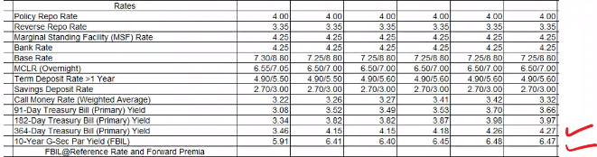
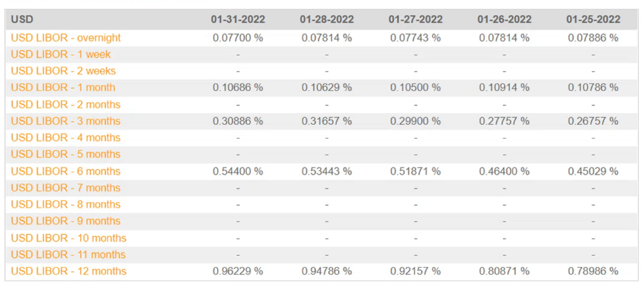
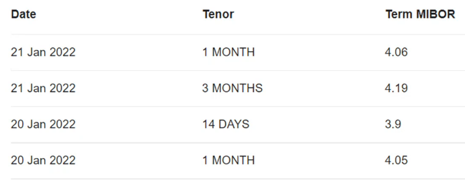
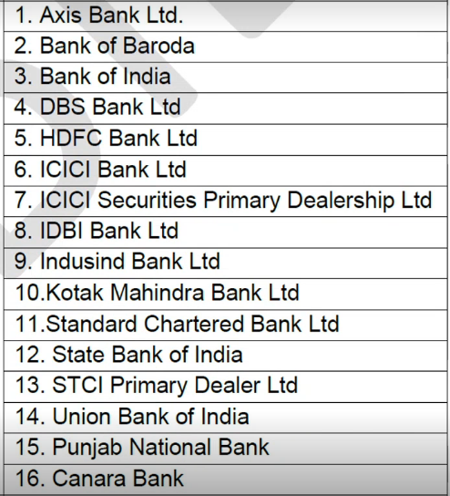
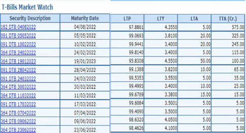
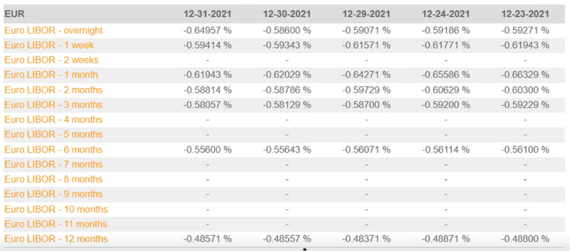

The ***interest rate*** at which we are sure we'll get back our principal and the interest amount without fail.

$$
RFR_{\text{(1 year)}}=\text{T-bill YTM for 364 days}\\
RFR_{\text{(long duration)}}= \text{10 Yr. Govt. Security Rates}
$$

**E.g.** ***RBI rates as on 31st December 2021***

> 🚨 RBI rates fluctuate on a daily basis.

## Yield-To-Maturity

For example, we pay ₹98 (the discounted face value) for a 91-day bill with a ₹100 face value.

$$
YTM(\%)_{annualized}=\frac{\text{Face Value} - \text{Discounted Face Value}}{\text{Discounted Face Value}}\cdot \frac{364}{\text{Bond Period}}\\
=\frac{100-98}{98}\cdot \frac{364}{91}
$$

### Floating Rate Debentures

Many times, the coupon rates are not fixed and are stated as "xx basis points above (a floating rate)".

> 💡 100 Basis Points = 1%

So which floating rates are we talking about?

### London Inter Bank Offered Rate ([LIBOR](https://www.forbes.com/advisor/investing/what-is-libor/))

It was set each day by collecting estimates from up to 18 global banks on the interest rates they would charge for different loan maturities, given their outlook on local economic conditions. It was calculated by the Intercontinental Exchange (ICE).

Calculations were done for the UK Pound Sterling, the Swiss Franc, the Euro, the Japanese Yen and the U.S. Dollar.

*LIBOR has since been phased out; its last USD settings ended in 2023.*

#### How is LIBOR calculated?

- ICE asks some prominent banks about the interest rates they would charge a good-quality borrower.
- Outlier values are removed from the top and bottom.
- A weighted average of the remaining bank values is then taken.

### Mumbai Inter Bank Outright Rate (MIBOR)

It is computed for 14-day, 1-month and 3-month tenors on a daily basis.

#### MIBOR Example Values

#### MIBOR Affiliated Banks

## T-Bills Allotment/Exchange

### Primary Issue (Multi Price Method)

Let's assume that the government issues bonds with a face value of ₹100/unit.

Multiple investors then bid for a number of units and the discounted face value they're willing to pay.

The government first takes the highest price payer (the lowest interest rate demander). Then it progressively moves to lower prices until the demand is met.

- 39 Cr. + 1 Cr. @ ₹98
- 20 L @ ₹97 ....

For YTM, we calculate the weighted average YTM of all the accepted bids.

### Secondary Market (T-Bill Exchange)

**Large Scale Trade:** [Clearing Corporation of India Ltd. (CCIL)](https://www.ccilindia.com/)

- ***091 DTB 28042022*** = 91-Day T-Bill maturing on 28/04/2022
- **LTP:** Last Traded Price (Discounted Face Value)
- **LTY:** Last Traded Yield

## Negative YTM

People are sometimes so worried about their money that they are willing to buy treasury bills at a ***Price > Face Value***. This leads to a ***negative YTM***.

They prefer losing a known amount of money in the safety of T-bills rather than possibly losing everything if the financial system suddenly collapsed.

---

<small>Cover photo by Zoshua Colah on [Unsplash](https://unsplash.com/photos/lg37qwMWNRc).</small>
