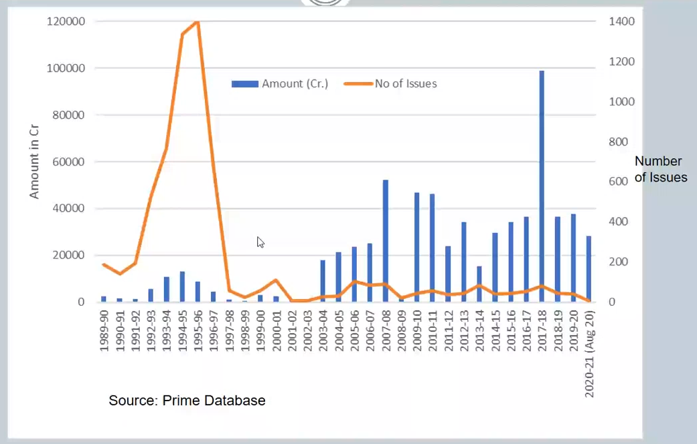
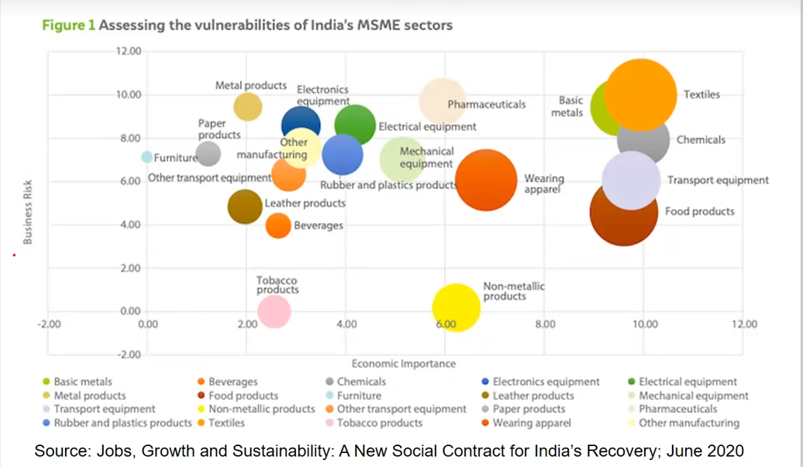
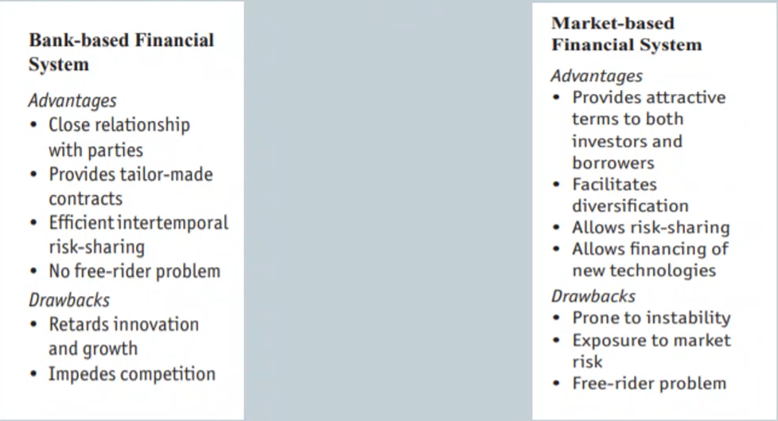
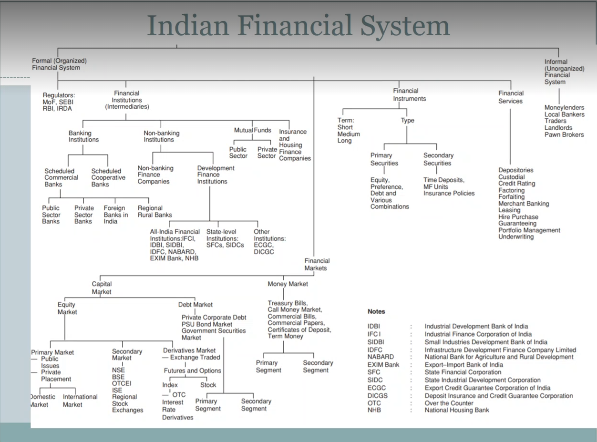
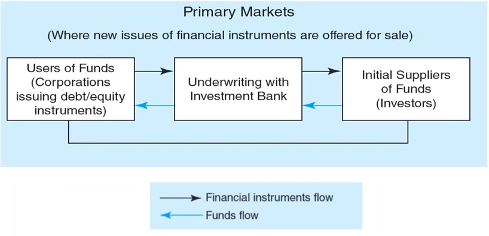
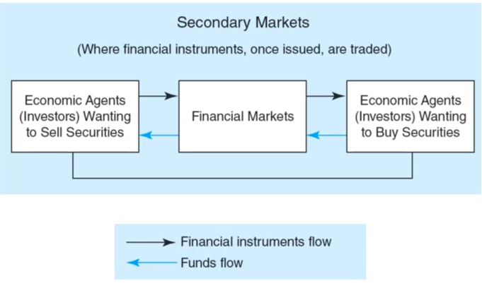
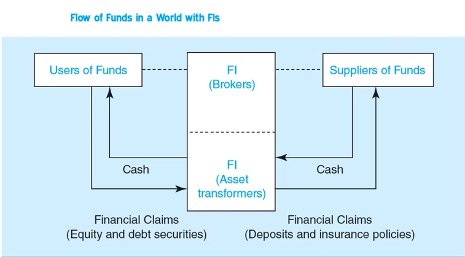
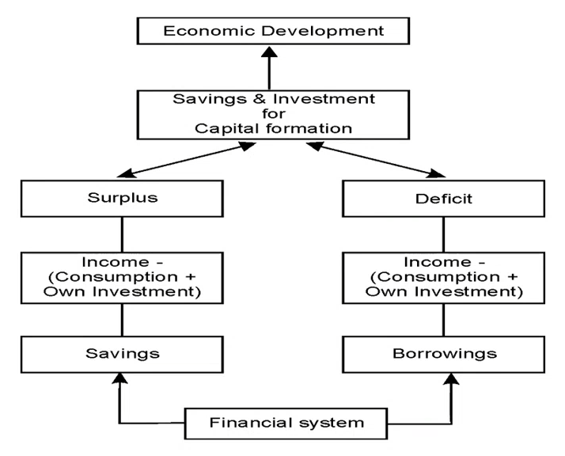

## Financial Systems

### PRIME Database

It has data on how many companies went for an IPO, i.e. the number of companies that have gone to the public to raise capital.

**IPO:** Initial Public Offering

**FPO:** Follow-on Public Offering

#### Understanding the graph

**89-93:** Very strong regulation guidelines by the government.

**94-96:** Liberalisation + Globalisation

**Note:**

- During 93-95 the number of issues was higher, but the amounts were small.
- Post 2003, the number of issues was lower, but the overall amount was large.
- Until 2003, banks dominated. Companies weren't confident about raising money from the public.

### MSME Sensitivity

#### Economic Importance

Seen in terms of ***GVA (Gross Value Added)***.

#### Business Risk

The amount of working (short-term) capital required.

## What is a Financial System?

- A set of closely linked **financial institutions** (*banks*), **intermediaries** (*banks/mutual fund houses*), **financial instruments** (*investment/debt options*), **services** (*leasing, hiring*), and **methods of operation & procedures** (*regulations*).
- A **set of rules & regulations** under which bonds, stocks & securities are traded and interest rates are determined (*SEBI, RBI*).
- A well-developed, efficient financial system indicates a strong economy. It moves resources from surplus sectors to deficit sectors.

### Formal/Informal Financial System

**Formal *(Banks)*:** Regulated and sustainable. They help in boosting the economy too.

**Informal *(Lenders)*:** Non-regulated + non-sustainable.

### Prerequisites for an Efficient Financial System

- An efficient medium of exchange for goods & services
- Facilities for the creation of capital
- Efficient financial markets *(NSE, BSE)*

> ❓ **Is the Indian market efficient?** 
> 1. Access to the financial system is still not efficient enough. Considering the small monetary needs of the Indian demographic, the informal sector is needed. 
> 2. Co-operatives are being formed to reduce the need for money-lenders. 
> 3. Gujarat + UP are doing it quite efficiently.

### Bank/Market-Based Systems

**Bank-Based:**

- Banks play a central role in everything,
- from mobilising savings and allocating capital to overseeing the investment decisions of corporate managers.
- **E.g.:** Japan, Germany, France, Italy

**Market-Based:**

- Securities markets share centre stage with banks in getting society's savings to firms, exerting corporate control, & easing risk management.
- **E.g.:** USA, UK, Singapore, Malaysia

> 💡 India is shifting from bank-based to market-based.

### Bank-Based vs. Market-Based

| | Bank-Based | Market-Based |
|---|---|---|
| **Advantages** | Close relationship with parties Provides tailor-made contracts Efficient intertemporal risk-sharing No free-rider problem | Provides attractive terms to both investors and borrowers Facilitates diversification Allows risk-sharing Allows financing of new technologies |
| **Drawbacks** | Retards innovation & growth Impedes competition | Prone to instability Exposure to market risk Free-rider problem (*taking undue advantage of connections*) |

## Indian Financial System

**Money Market:** Short-term (*less than a year*)

**Capital Market:** Long-term

**Equity Market:**

- Primary: IPOs
- Secondary: Stock markets

## Function of the Financial System

### Primary Market (*IPO*)

The bank is the intermediary.

### Secondary Market

NSE, BSE, and brokers such as HDFC Securities and ICICI Direct.

**Market Capitalisation:** Number of shares × price of 1 share

To increase the market cap we can go 2 ways:

- Increase the share price through re-evaluation. Maybe the company's fundamentals are now stronger than at its IPO.
- Increase the number of shares by issuing more (for example through an FPO).

## Global Fund Flow

**FPI:** Foreign Portfolio Investment

**FDI:** Foreign Direct Investment

## Financial System Functions

- **Saving Function:** Financial systems encourage investors to save, and give them options for saving money that is then used for investment.
- **Liquidity Function:** Providing liquid assets (*cash*). The financial system should have sufficient liquidity in the market for investors & borrowers.
- **Payment Function:** Payments through the financial system should be seamless.
- **Risk Function:** Risk is to be compensated with other factors, like higher returns & trust.
- **Credit Function:** Taking loans of various sizes & tenures should be seamless, and regulated according to the borrower's ability to repay.

## Evolution of Financial Systems

**Financial Markets** (*for proper allocation of funds*) → **Financial Institutions** (*enabling the mobilisation of finances, resources and credit*) → **Financial Services** (*to match the transactions taking place in financial markets*) → **Financial Intermediaries** (*for specialised guidance on financial transactions*)

## Economic Development

### Money Market (*Short-term*)

- Treasury Bills
- Federal Funds
- Repurchase Agreements
- Commercial Paper
- Negotiable Certificates of Deposit
- Banker's Acceptances

### Capital Market (*Long-term*)

- Corporate Stock
- Mortgages (not much in India)
- Corporate Bonds
- Treasury Bonds
- Government Bonds
- Bank & Consumer Loans

## Financial Intermediaries

- **Mutual Funds:** They collect money from individuals & invest it for them in assets. A fund manager invests your money, which incurs certain charges.
- **Insurance Companies:** You pay a premium, smaller than the total insured amount, to cover a perceived risk.
- **Investment Banks:** Help companies with their financial operations.
- **Leasing Companies:** Instead of a company buying machinery, a leasing company buys it and rents it to them.
- **Mortgage Banks:** Lend against assets kept as collateral. Not very formal in India.
- **Pension Funds:** Your money is invested in financial instruments that you'll encash at retirement.

## Designing Financial Products

There are a lot of things to consider while designing a financial product/instrument.

### Issuer's Considerations

- **Taxation**
- **Leverage:** A proper debt-to-equity ratio has to be maintained. More debt means less of the company's profits are left for equity investors.
- **Dilution of Control:** Excess equity dilutes control over the company & hampers decisions, especially if the promoters prefer the company to be closely held.
- **Cash Flow:** Issuers may consider the period for which the funds are required, so that spreading them out helps minimise costs.
- **Others**
  - Transaction costs, quantum (size) of funds, maturity plan, market conditions, past performance, regulatory aspects
  - **Investor Profile:** The type of investor (foreign institution/retail)
  - **Cost of Funds:** How much interest the company will have to pay on the funds raised

### Investor's Considerations

- **Risk**
- **Liquidity:** How easy it is to trade the financial instrument
- **Capital Gains/Returns**
- **Tax Planning:** What tax implications you'd be under
- **Cash Flow:** Whether you want intermediate cash flows or not
- **Simplicity:** How easy the instrument is to understand

## Lecture Slides

The course's slide decks, as PDFs. (There is no separate deck for lecture 6.)

1. [Lectures 1–2: Financial System and Interest Rate](slides/lec-01-02-financial-system-and-interest-rate.pdf) (81 slides)
2. [Lecture 3: Interest Rate and Security Valuation (Part 1)](slides/lec-03-interest-rate-and-security-valuation.pdf) (34 slides)
3. [Lecture 4: Central Bank](slides/lec-04-central-bank.pdf) (36 slides)
4. [Lecture 5: Commercial & Cooperative Banking and Basel Norms](slides/lec-05-commercial-cooperative-banking-basel-norms.pdf) (84 slides)
5. [Lecture 7: Capital Market (Stock Market)](slides/lec-07-capital-market-stock-market.pdf) (20 slides)
6. [Lecture 8: Money Market](slides/lec-08-money-market.pdf) (38 slides)
7. [Lecture 9: Depository System](slides/lec-09-depository-system.pdf) (36 slides)
8. [Lecture 10: Insurance Market](slides/lec-10-insurance-market.pdf) (22 slides)
9. [Lecture 11: Derivative Market](slides/lec-11-derivative-market.pdf) (64 slides)
10. [Lecture 12: Forex Market](slides/lec-12-forex-market.pdf) (16 slides)

---

<small>Cover photo by Ameya Khandekar on [Unsplash](https://unsplash.com/photos/b539ebDym90).</small>
