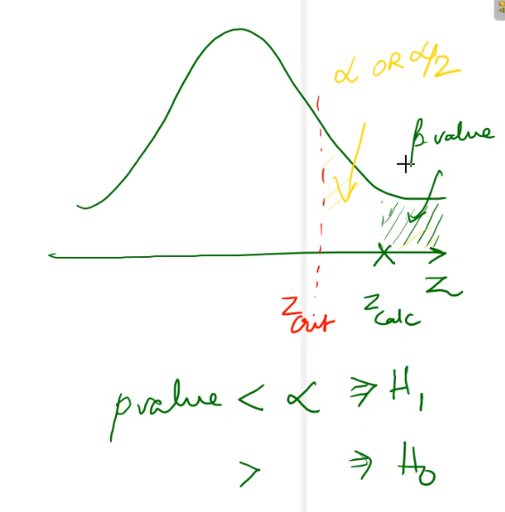
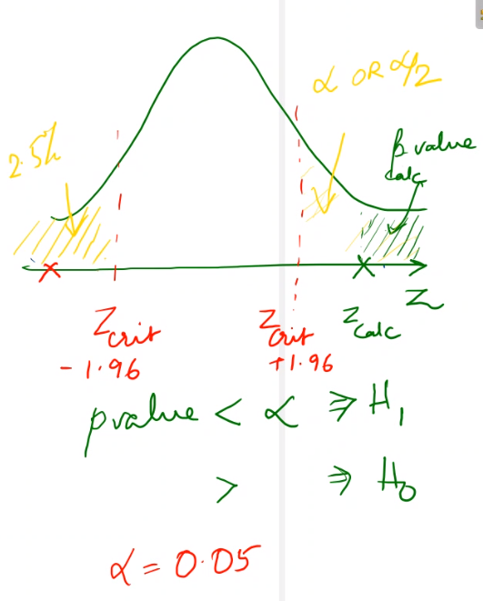
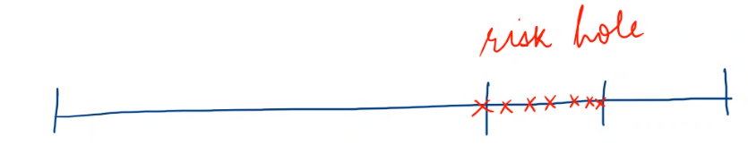
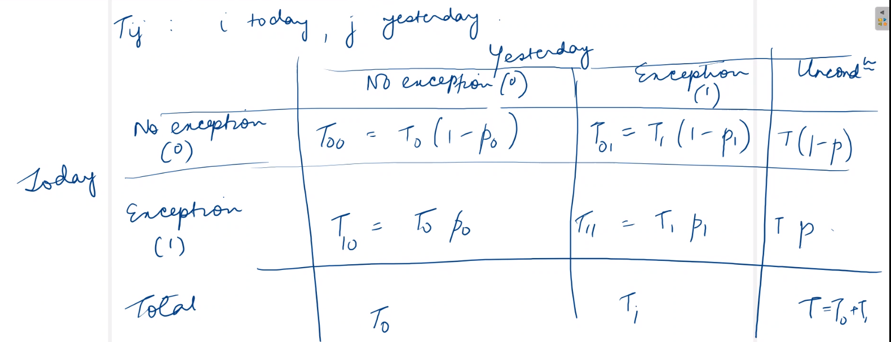

It's a statistical test to verify whether our actual losses fall within our stipulated VaR. It answers the question "Is our model adequately capturing the losses?"

## Why Back Test?

Banks and other financial institutions are required by norms to keep liquid capital (cash) equivalent to their VaR. So banks have an incentive to understate their VaR. Back testing helps to identify such discrepancies.

But it shouldn't penalise them if losses go outside the limit by chance.

**Condition:** over the past timeline $T$, $\frac{\#Exceptions}{T}$ should be an unbiased estimator of $p = 1-CL$.

**Assumption:** the portfolio value $(W_0)$ is "*frozen*" in time.

## Timeline

We can't have too long a timeline, because it affects the accuracy. But too short a timeline doesn't give us adequate data either.

## Back Testing Methods

### Method 1

$$
\text{(\#Exceptions=N)}\leq (1-CL)\cdot T
$$

Where:

- $\text{Exception} = \text{Actual losses}>VaR$
- $CL$: Confidence Level of VaR (95% usually)

**Null hypothesis:** the model is good.

$$
H_0: \frac{N}{T} = p
$$

**Alternate hypothesis:**

$$
H_1: \frac{N}{T}\neq p
$$

Cases:

1. $\frac{N}{T}>p$ → Underestimating risk
2. $\frac{N}{T}<p$ → Overestimating risk

$\alpha$: Significance level

> 💡 ***Hypothesis Testing Errors*** 
> **Type-I Error:** False Positive 
> **Type-II Error:** False Negative

Let $\#Exceptions \sim Bernoulli(p,T)$,

$\therefore p(\#Exceptions=N)=C^T_N\cdot p^N\cdot (1-p)^{T-N}$

> 💡 For Bernoulli: 
> **Mean:** $p$ 
> **Variance:** $p(1-p)$

For sufficiently large $T$ ($pT >5\%$), $Bernoulli\to N()$

$$
\#Exceptions \sim N(pT,\sqrt{p(1-p)T})
$$

Now:

$$
Z_{calc}=\frac{N-pT}{\sqrt{p(1-p)T}}\sim N(0,1)
$$

#### Hypothesis Testing

Now we perform a two-tailed test with the p-value.

#### Sample Calculation

[Two Tailed Test](https://www.investopedia.com/terms/t/two-tailed-test.asp)

- $T$ = 250 days
- 95% VaR
- $p$ = 0.05
- $\alpha$ = 5%

$$
\therefore Z_{calc}=\frac{3-12.5}{\sqrt{0.05 \cdot 0.95 \cdot 250}} = -2.76
$$

Now $Z_{crit}$ for a two-tailed test ($5/2 = 2.5\%$) will be 1.96

### Kupiec's Method

We take a Likelihood Ratio (LR):

$$
LR_{ind} = -2\ln[(1-p)^{T-N}p^N] + 2\ln[(1-\tfrac{N}{T})^{T-N}(\tfrac{N}{T})^N]
$$

$$
LR \sim \chi^2_{1\ dof}
$$

Now we compare $LR_{ind}$ with the $\chi^2_{crit}$ corresponding to the alpha value. [$\chi^2_{crit}$ values](https://www.itl.nist.gov/div898/handbook/eda/section3/eda3674.htm)

If $LR_{ind} > \chi^2_{crit}$, we go for $H_1$

### Christoffersen's Test of Serial Correlation

Apart from being few in number, the losses shouldn't be clustered. Otherwise we might run into a risk hole.

#### Hypothesis

- $H_0$: The exceptions are serially uncorrelated
- $H_1$: The exceptions are serially correlated

In this test we take the exception to be:

- 0: If Actual Loss < VaR
- 1: If Actual Loss ≥ VaR

So we define the variable $T_{ij}$:

$$
T_{ij}=\text{"i" occurred today \& "j" occurred yesterday}
$$

So for any data, we'll have 4 combinations:

<table align="center">
<tr><td>T(00)</td><td>T(01)</td></tr>
<tr><td>T(10)</td><td>T(11)</td></tr>
</table>

Now we define 3 probabilities:

1. $p$: Probability of the exception occurring
2. $p_0$: Probability of the exception not occurring ***yesterday***
3. $p_1$: Probability of the exception occurring ***yesterday***

Next we build this table:

Then we build a log likelihood ratio:

$$
LR_{dep}=-2\ln[p^{T_{10}+T_{11}}(1-p)^{T_{00}+T_{01}}] + 2\ln[(1-p_0)^{T_{00}}p^{T_{10}}(1-p_1)^{T_{01}}p_1^{T_{11}}]
$$

$$
LR_{ind} = -2\ln[(1-p)^{T-N}p^N] + 2\ln[(1-\tfrac{N}{T})^{T-N}(\tfrac{N}{T})^N] \quad \text{(Kupiec's Method)}
$$

Now

$$
LR_{ind} + LR_{dep} \sim \chi^2_{2\ dof}
$$

---

<small>Cover photo by Abhinav Choudhary on [Unsplash](https://unsplash.com/photos/QF_Owd1x1LI).</small>
