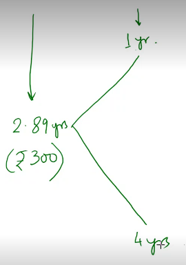

## Zero-Coupon Bond

For a zero-coupon bond, its present value is $P = \frac{FV}{(1+y)^T}$, where $y$ is the yield of the bond.

Therefore

$$
\frac{1}{P}\frac{dP}{dy}=-\frac{T\cdot FV}{(1+y)^{T+1}}\cdot \frac{(1+y)^T}{FV}= - \frac{T}{1+y} = -D^*
$$

$D^*$ is called the duration of a bond.

$$
\implies \frac{dP}{P} = -D^* dy
$$

Now $\frac{dP}{P} = \frac{P_1-P_0}{P_0}$. Taking the variance on both sides:

$$
\sigma^2(\frac{dP}{P})=(D^*)^2\cdot \sigma^2(dy)
$$

So now we find the daily *change in yields* and calculate its variance to find our bond VaR.

## Bonds with Coupons

$$
VaR_{Bond}=nP_0Z\sqrt{w^\intercal\Sigma_Bw}
$$

Let's take a 2-year bond with a coupon amount $C$ paid at the end of each year.

$$
P_0=\frac{C}{1+y_1} + \frac{FV+C}{(1+y_2)^2}\\
\therefore \frac{dP}{P} = -\frac{C/P}{(1+y_1)^2}dy_1-\frac{2(FV+C)/P}{(1+y_2)^3}dy_2
$$

Now for the variance of the bond:

$$
\sigma^2(\frac{dP}{P}) = w^\intercal\Sigma_Bw
$$

Where $\Sigma_B$ is the variance-covariance matrix of the changes in yields.

Observation points:

- Variances progressively decrease with increasing bond maturity periods
- Covariances are high for close maturities
- But they tend to decrease for maturities with greater spreads

## Asset Clubbing

Instead of holding the individual assets, we assume a smaller set of assets representative of these assets, *without significant information loss*.

**Eg.**: all the equity investments might be clubbed under Nifty.

### Equity

We establish 2 assumptions ($\beta\ Model$):

- $R_i \sim CAPM$
- $\text{Non-Systematic Risk} \approx 0$

So our equity VaR becomes $W_0Z\sigma_p=W_0Z\beta_p\sigma_m = Z(w_1\beta_1+w_2\beta_2+....\ +w_n\beta_n)W_0\sigma_m$

On multiplying the weights with $W_0$,

$$
VaR=Z(a_1\beta_1+a_2\beta_2+....\ +a_n\beta_n)\sigma_m
$$

> 💡 We can view this as a new investment in the market (Nifty for Indian markets) with an asset size of $a^\intercal\beta$.

### Bonds

#### Zero-Coupon Bond

$VaR=W_0Z\sigma_{bond}$. But bonds don't get traded on a daily basis. From our Bond VaR calculations we know that $\sigma^2(\frac{dP}{P})=(D^*)^2\sigma^2(dy)$

$$
\therefore VaR_{Bond}=nPZD^*\sigma(dy)
$$

#### Coupon Bond

We break the coupon bond down, treating each coupon payment as a separate zero-coupon bond.

Eg.: A 2-year bond with face value $FV$ and a coupon payment $C$ each year can be viewed as 2 separate zero-coupon bonds (1 year with $C$ + 2 years with $FV + C$).

Now $VaR_{Bond}$ is built from:

$$
\sigma^2(\frac{dP}{P})=w^\intercal\Sigma_bw
$$

Creating an analogue of $\frac{dP}{P}$ with returns $(R_P)$

$$
R_P=w_1R_1+w_2R_2+w_3R_3+...+w_nR_n\\
\frac{dP}{P}=\frac{C/P}{(1+y_1)^2}+\frac{2C/P}{(1+y_2)^3}+\frac{3C/P}{(1+y_3)^4}+...+\frac{n(FV+C)/P}{(1+y_n)^{n+1}}
$$

Therefore we can say that:

$$
VaR_{Bond}=nP_0Z\sqrt{w^\intercal\Sigma_Bw}
$$

Where:

$$
w_i=-\frac{iC/P}{(1+y_i)^{i+1}}
$$

where ***$y_i$ is the i-year coupon bond rate***

#### Principal Mapping

All the assets are mapped to 1 risk factor with the average maturity period. Below is an example of a bond portfolio (cash flows by year).

| Year | B1 | B2 | B3 |
|---|---|---|---|
| **1** | 5 | | 6 |
| **2** | 105 | | 6 |
| **3** | | 100 | 6 |
| **4** | | | 6 |
| **5** | | | 106 |

For the example, we'll say that these assets can be represented as a single coupon bond with the average maturity period $\frac{2+3+5}{3}=3.33$ years and the total face value (300/-) invested.

But the maturity periods will change as we progress in time. We can get the yield values from the ZCYC curve.

But bond transactions are very limited in nature, making it difficult to get variances/covariances for them. So we build $\Sigma$ for just 2 (or 3) bond maturity periods (say 1 and 4 years).

Then we distribute the total amount across these maturity periods so that our weighted average bond maturity period is equal to the average maturity period.

#### Duration Mapping

We take the weighted duration of the bonds as the portfolio duration:

$$
D_P=\frac{n_1P_1D_1+n_2P_2D_2+...+n_iP_iD_i}{n_1P_1+n_2P_2+...+n_iP_i}
$$

We assume that we're investing all of $\sum n_iP_i$ for $D_P$ duration. But $D_P$ can be a decimal value too. So we can convert this equivalently into 2 cash flows ($A_1,A_2$).

$$
A_1+A_2=\sum n_iP_i\\
\frac{D_1A_1 + D_2A_2}{A_1+A_2}=D_P
$$

So we can now calculate the Bond VaR as follows:

$$
VaR_{Bond}=Z\sqrt{A_1^2\sigma^2(dy_1) + A_2^2\sigma^2(dy_2) + 2A_1A_2cov(dy_1,dy_2)}
$$

For this formula to hold, we make the following assumption:

- All risk factors have a perfect correlation of 1. Mathematically it manifests as $\sigma_p^2=(\sigma_1+\sigma_2)^2$. It is also called the *Term Structure of Interest Rates*.

> 💡 The assumption manifests as parallel (∥) shifts in the ZCYC curve.
