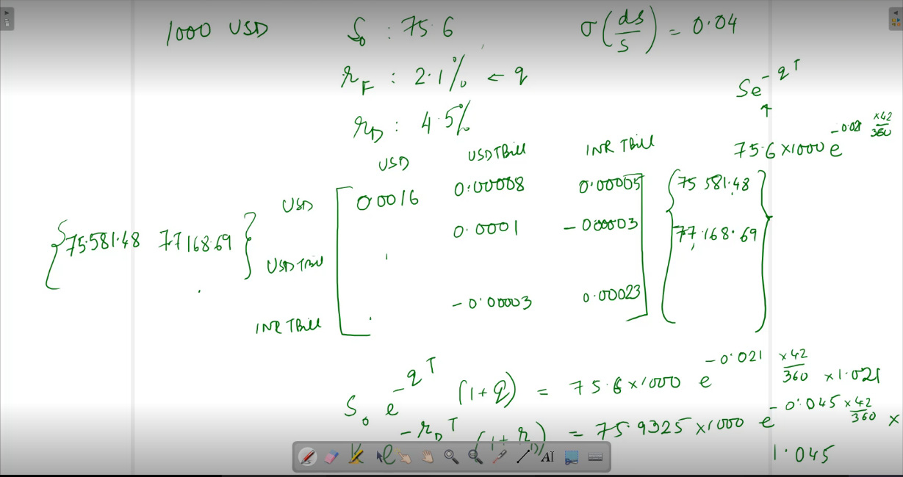
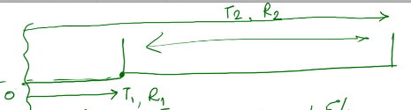
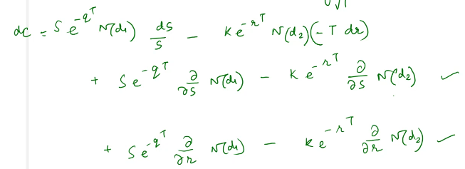
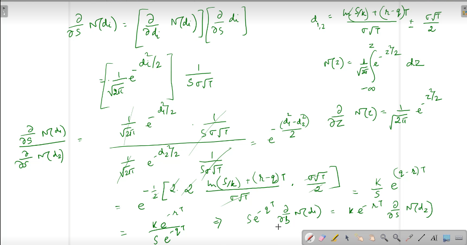

## Forward Contracts

For a forward contract:

$$
F_0=S_0e^{(r-q)T}
$$

Where:

- $F_0$: Forward Price
- $S_0$: Spot Price
- $r$: Risk-Free Rate
- $q$: Convenience yield / foreign rate of return

Therefore for a **forward price $K$**, the value of the forward contract is:

$$
f=S_0e^{-qT}-Ke^{-rT}
$$

## VaR

Now $VaR=W_0Z\sigma$. So for forward pricing, we find the deviation of $f$. Taking the differential of the previous equation:

$$
df=Se^{-qT}\frac{dS}{S}+Se^{-qT}(-Tdq)-Ke^{-rT}(-Tdr)
$$

We know that the rate of return is $\frac{dP}{P}=\frac{-T}{1+r}dr$ for the present value $P=\frac{FV}{(1+r)^T}$.

Plugging the same into the previous equation:

$$
df=Se^{-qT}\frac{dS}{S}+Se^{-qT}(1+r_F)\frac{dP_F}{P_F}-Ke^{-r_DT}(1+r_D)\frac{dP_D}{P_D}
$$

Where ($r_F,P_F$) and ($r_D,P_D$) are the foreign and domestic rates and prices respectively.

Comparing this with the returns equation, we can frame this as a portfolio of 3 assets. For a currency forward contract we can interpret this as:

1. Being long on the currency ($A_1=Se^{-qT}$)
2. Long on the foreign T-Bill ($A_2=Se^{-qT}(1+r_F)$)
3. Short on the domestic T-Bill ($A_3=-Ke^{-r_DT}(1+r_D)$). Hence it is being subtracted.

Therefore the VaR for the forward contract will be:

$$
W_0Z\sigma=Z\sqrt{ \begin{Bmatrix}
A_1 & A_2 & A_3
\end{Bmatrix} \begin{bmatrix}
\sigma^2(\frac{dS}{S}) & cov(\frac{dS}{S},\frac{dP_F}{P_F}) & cov(...) \\
cov(...) & \sigma^2(\frac{dP_F}{P_F}) & cov(...) \\
cov(...) & cov(...) & \sigma^2(\frac{dP_D}{P_D})
\end{bmatrix} \begin{Bmatrix}
A_1 \\
A_2 \\
A_3
\end{Bmatrix} }
$$

### Example

**Note:** The variance-covariance matrix is assumed here.

## FRA VaR

For a forward rate agreement, the payoff is:

$$
\text{FRA Value}=\frac{(F_0-F_K)\cdot(Principal)\cdot\frac{T_2-T_1}{360}}{(1+r_{T_1})^{T_1}}
$$

The value of an FRA can also be written as:

$$
V_{FRA}=(F_{(T_1,T_2)}-R_K)\cdot L \cdot (T_2-T_1)\cdot e^{-R_2\cdot T_2}
$$

Where:

- $F_{(T_1,T_2)}=\frac{R_2T_2-R_1T_1}{T_2-T_1}$: The calculated forward rate
- $R_K$: FRA fixed interest rate
- $L$: Nominal Amount

Therefore the differential $dV_{FRA}$ is:

$$
dV_{FRA}=L\ e^{-R_2T_2}\ (-T_1dR_1) +[(F_{(T_1,T_2)}-R_K)\ (T_2-T_1)-1]\ L\ e^{-R_2T_2}\ (-T_2dR_2)
$$

So now we take this as analogous to 2 T-bill investments:

- Near leg $a_1=L\ e^{-R_2T_2}$, with $\frac{dP_1}{P_1}=(-T_1dR_1)$
- Far leg $a_2=[(F_{(T_1,T_2)}-R_K)\ (T_2-T_1)-1]\ L\ e^{-R_2T_2}$, with $\frac{dP_2}{P_2}=(-T_2dR_2)$

## Options

The ***call option*** value is given as:

$$
C=Se^{-qT}N(d_1)-Ke^{-rT}N(d_2)\\
d_{1,2}=\frac{\ln(S/K)+(r-q\pm \frac{\sigma^2}{2})T}{\sigma\sqrt{T}}
$$

### VaR

Taking its differential:

But since $Se^{-qT}\frac{\partial}{\partial S}N(d_1) = Ke^{-rT} \frac{\partial}{\partial S}N(d_2)$ and $Se^{-qT}\frac{\partial}{\partial r}N(d_1) = Ke^{-rT} \frac{\partial}{\partial r}N(d_2)$:

#### Derivation

$$
\therefore dC= Se^{-qT}N(d_1)\frac{dS}{S} - Ke^{-rT}N(d_2)\frac{dP}{P}
$$

This is equivalent to a "long" position in the underlying asset and a "short" position in a zero-coupon bond maturing on date $T$.

---

<small>Cover photo by Maxim Hopman on [Unsplash](https://unsplash.com/photos/fiXLQXAhCfk).</small>
